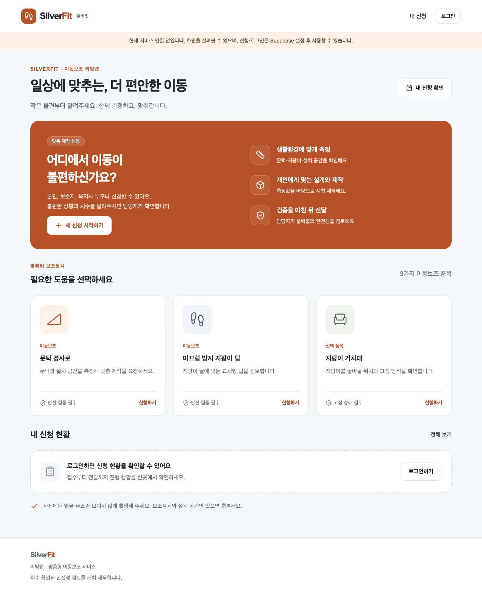

# SilverFit · 실버핏

한국어 모바일 중심 Next.js/TypeScript + Supabase 이동보조 제작 관리 MVP.
문턱 경사로, 미끄럼 방지 지팡이 팁, 지팡이 거치대를 접수하고 측정 → 설계 → 시험 제작 → 안전 검토 → 승인 → 전달 → 평가를 관리합니다.

## 주요 기능

| 구분 | 제공 기능 |
|---|---|
| 사용자·보호자·복지사 | 회원가입·로그인, 대리 신청, 제품별 치수·환경·사진 입력 |
| 신청 추적 | 접수부터 측정·설계·시험 제작·안전성 검토·전달·평가까지 상태와 이력 확인 |
| 관리자 | 신청 목록·상태 필터, 설계 파일 버전, 출력물 조건·결과 기록 |
| 안전성 | 현재 설계·출력물의 최신 통과 기록 요구, 재설계·부적합·문제 신고 시 승인 철회 |
| 피드백 | 만족도, 개선 요청, 사용 중 문제 신고 |
| 개인정보 | 소유자별 DB 접근제어, 비공개 사진·설계 스토리지, 만료되는 파일 링크 |

## 화면 예시



## 기술 구성

Next.js App Router · TypeScript · React · Supabase Auth/PostgreSQL/Storage · Zod · Vitest/PGlite · Playwright.

## 실행

Node.js 22 LTS 이상과 pnpm 11을 권장합니다 (Next.js 최소 20.9).

```sh
git clone https://github.com/xxhee720/silverfit.git
cd silverfit
corepack enable
corepack prepare pnpm@11.19.0 --activate
pnpm install --frozen-lockfile
cp .env.example .env.local
pnpm dev
```

http://localhost:3000 에서 확인합니다. 환경변수가 없으면 홈·신청 화면 미리보기만 가능하고 실제 저장·로그인은 불가합니다. 데모 데이터나 가짜 성공 응답은 사용하지 않습니다.

`.env.local`에 Supabase 프로젝트 Settings → API에서 다음 두 값을 넣습니다.

```dotenv
NEXT_PUBLIC_SUPABASE_URL=https://PROJECT.supabase.co
NEXT_PUBLIC_SUPABASE_PUBLISHABLE_KEY=공개_publishable_또는_anon_키
```

서비스 역할 키는 앱에 넣지 않습니다. 브라우저·서버 모두 로그인한 사용자의 권한과 RLS로 접근합니다.

## Supabase 초기화

1. Supabase 프로젝트를 만듭니다. SQL Editor에서 `supabase/migrations/202610090001_initial.sql` 전체를 새 프로젝트에 한 번 실행합니다. Auth/Storage는 Supabase 제공 스키마를 사용합니다.
2. 또는 Supabase CLI 설치 후 `supabase init`, `supabase link --project-ref PROJECT_REF`, `supabase db push`를 실행합니다. 기존 프로젝트에 적용하기 전 백업과 마이그레이션 충돌 확인이 필요합니다.
3. Authentication → URL Configuration: Site URL을 로컬 `http://localhost:3000` 또는 실제 배포 주소로 지정합니다. Redirect URLs에 각 주소의 `/auth/confirm`, `/auth/reset`을 허용합니다.
4. 이메일 확인을 켜고 아래 이메일 템플릿을 설정합니다. 운영 환경에서는 SMTP 발송 서비스를 연결하고 발송 제한·스팸 도달 여부를 확인합니다.
5. 앱에서 회원가입 → 이메일 확인 → 로그인합니다.
6. 관리자로 지정할 계정을 SQL Editor에서 별도 등록합니다.

```sql
insert into public.admin_users(user_id)
select id from auth.users where email = '운영자_실제_이메일'
on conflict do nothing;
```

이메일 확인 템플릿(Confirm signup) 링크:

```html
<a href="{{ .SiteURL }}/auth/confirm?token_hash={{ .TokenHash }}&type=signup"
  >가입 확인</a
>
```

Reset password 템플릿 링크:

```html
<a href="{{ .SiteURL }}/auth/confirm?token_hash={{ .TokenHash }}&type=recovery"
  >비밀번호 재설정</a
>
```

계정 역할(본인/보호자/복지사)은 신청 맥락일 뿐 관리자 권한이 아닙니다. 관리자 테이블은 일반 계정이 읽거나 수정할 수 없습니다. 보호자·복지사는 본인의 계정으로 대리 신청하고 동의를 확인합니다. 동일 신청의 여러 계정 공동 관리는 이번 MVP 범위에 포함하지 않습니다.

## 기능과 운영 흐름

- `/`: 품목 선택, 내 최근 신청. 주황·흰색 브랜드, 큰 버튼, 모바일 하단 메뉴.
- `/auth`: 가입·로그인·비밀번호 재설정. 서버에서 세션 재검증, 쿠키 갱신.
- `/applications/new`: 제품별 mm 치수, 환경·연락처, 대리 신청, 동의, 선택 사진.
- `/applications`: 자신의 신청 목록.
- `/applications/[id]`: 단계별 상태, 원본 치수, 비공개 사진, 버전별 설계 파일, 출력물·안전성·후기·상태 이력.
- `/admin`: 상태 필터, 안전 검토 대기·사용 문제 신고 집계, 최근 200건 목록.
- 관리자 상세 화면: 설계 파일, 출력 조건·결과, 전문가·시험 기준·근거 등록 및 상태 변경.

표준 절차:

1. 신청 → 측정 확인 → 설계 검토.
2. STL/STEP/STP/3MF/SCAD 원본 등록 (버전 자동 증가, 파라미터 스냅샷 저장).
3. 시험 제작으로 상태 변경 → 현재 버전의 실제 출력물 기록.
4. 안전성 검토로 상태 변경 → 시험 방법·판정 기준·결과 근거·검토 전문가 입력.
5. 시험 통과 후 **별도로 사용 승인** → 전달 → 평가 → 종료.

모든 품목에 검토를 요구합니다. 경사로·팁은 안전중요 품목으로 표시합니다. 시험 제작은 승인 전 가능하며, 실제 사용·전달은 현재 설계의 완료된 출력물에 대한 최신 통과 기록 없이는 불가합니다. 전문가의 검토 사실과 시험 근거는 운영자가 확인해 기록합니다. 앱이 물리 시험이나 전문가 자격을 자동 검증하는 것은 아닙니다.

새 설계 등록 시 이전 승인은 무효이고 설계 검토 단계로 돌아갑니다. 부적합 기록, 파손·미끄러짐 신고는 안전성 검토 단계로 되돌려 사용 승인을 철회합니다. 운영자는 전달받은 사용자에게 직접 중단·회수 연락을 해야 합니다 (자동 SMS/메일 알림 없음). 전달 후 개선품은 새 신청으로 등록해 추적합니다.

사진·설계 업로드 성공 후 메타데이터 등록이 실패하면 원본이 스토리지에 남을 수 있습니다. 사진 실패 시 신청은 유지하고 상세 화면에서 재업로드하도록 안내합니다. 운영자가 주기적으로 참조 없는 파일을 점검해 정리해야 합니다.

## 테스트와 빌드

```sh
pnpm typecheck
pnpm test
pnpm build
pnpm exec playwright install chromium
pnpm test:e2e
```

- Vitest: 제품별 치수·동의·대리 신청·리다이렉트 검증.
- PGlite: 실제 PostgreSQL 엔진에서 마이그레이션 실행, 권한·RLS·스토리지 정책·안전 상태 전이 검증. Auth/Storage 스키마는 테스트용 대체 스키마이므로 실제 Supabase 인증/파일 서비스 통합 테스트를 대체하지 않습니다.
- Playwright: 미설정 상태의 홈·신청 이동, 모바일 가로 넘침, 보호 페이지 리다이렉트.
- 실제 계정·두 사용자·관리자로 수행할 운영 전 확인은 `docs/OPERATIONS.md`를 참고합니다.

## 배포

Vercel에서 이 저장소를 연결하고 Root Directory를 `.`으로 설정합니다. Framework Preset은 Next.js, Build Command `pnpm build`, Install Command `pnpm install --frozen-lockfile`. 두 공개 환경변수를 Preview/Production 각각 설정하고 배포합니다. Supabase Site URL·이메일 템플릿 주소를 실제 HTTPS 도메인으로 수정합니다. Preview는 별도 Supabase 프로젝트를 권장합니다.

일반 Node 서버에서도 `pnpm build && pnpm start`로 실행할 수 있습니다. HTTPS 리버스 프록시, 지속 실행 프로세스, 환경변수를 설정합니다. 정적 HTML export로는 서버 인증·액션을 제공할 수 없습니다.

이 저장소에는 실제 Supabase 프로젝트·실서비스 계정·배포 URL·물리 안전성 검증 결과가 포함되어 있지 않습니다. 프로젝트 연결과 운영 확인을 마친 후 실제 참여자 접수를 시작하세요.

## 자료 반영

2026 리빙랩 발대식 PPT의 주황·흰색 스타일, 과제계획서의 현장 관찰·측정·동의·안전성 검토·반복 개선을 반영했습니다. 계획서의 그립 모듈 품목보다 최근 사용자 확정 범위인 이동보조를 우선했습니다. 사진은 얼굴·주소를 제외하고 최소 수집합니다.

## 문서와 프로젝트 구조

- [데이터 구조·접근제어·CAD/STL 연동 방향](docs/ARCHITECTURE.md)
- [운영 시작·실계정 확인·개인정보 관리](docs/OPERATIONS.md)
- [구현 검증 결과와 미검증 항목](docs/VERIFICATION.md)
- [초기 DB 마이그레이션](supabase/migrations/202610090001_initial.sql)

```text
app/                    사용자·관리자 화면, 서버 액션, 인증·파일 경로
components/             신청 폼과 제작 관리 UI
lib/                    치수 검증, 인증, Supabase 클라이언트
supabase/migrations/    테이블·RLS·스토리지·안전 승인 함수
tests/                  입력·PostgreSQL·브라우저 테스트
docs/                   설계·운영·검증 안내와 화면 예시
```

CAD/STL 자동 생성과 프린터 직접 제어는 후속 연동 범위입니다. 현재는 설계 파일을 수동 등록하고 실제 출력물과 안전성 검토 이력을 관리합니다.

공식 구현 참고: [Next.js 설치](https://nextjs.org/docs/app/getting-started/installation), [Supabase 서버 인증](https://supabase.com/docs/guides/auth/server-side/creating-a-client?framework=nextjs), [Storage 접근제어](https://supabase.com/docs/guides/storage/security/access-control).

## 사진 촬영·치수 계산 (2026-10-11)

신청 화면에서 `사진 촬영`(모바일 후면 카메라 요청) 또는 `사진 선택`을 사용합니다. 브라우저와 기기에 따라 촬영 버튼이 파일 선택창을 열 수 있습니다. JPG/PNG/WebP 10MB 이하 사진을 로컬에서 최대 1600px JPEG로 변환하며 EXIF 메타데이터를 제거하고 2MB 이하로 제출합니다. HEIC는 JPEG로 변환 후 선택하세요.

자 또는 개인정보 없는 기준물을 측정 대상과 같은 평면에 두고 정면 촬영합니다. 기준 길이(mm)를 입력하고 기준물 양끝, 대상 양끝을 순서대로 지정하면 비율로 mm를 계산해 해당 입력란에 적용합니다. 자동 물체 인식·원근 보정·깊이 추정이 아닌 사용자 지점 지정 기반 계산입니다. 곡면·기울어진 사진은 오차가 크며 제작 전 담당자 실측이 필요합니다. 직접 값을 수정하면 그 항목의 사진 추정 근거 표시가 해제됩니다. 사진 교체 시 기존 값은 남지만 추정 근거는 해제되므로 다시 확인해야 합니다.

DB 연결 전에는 촬영과 계산을 체험할 수 있지만 제출은 비활성화됩니다. 실제 저장은 Supabase 인증과 환경변수 연결이 필요합니다. 기존 마이그레이션 다음에 `supabase/migrations/202610110001_photo_measurements.sql`을 적용하세요. 신규 프로젝트도 두 SQL을 날짜순으로 실행합니다. `applications.measurements`에 최종 mm 값, `measurement_evidence`에 기준 길이·사진 크기·정규화 측정 좌표·추정값을 함께 저장합니다. 서버와 PostgreSQL에서 계산값 및 필드 일치 여부를 확인하며 기존 RLS가 소유자/관리자 접근을 제한합니다. 증거는 사용자가 제공한 값이며 실제 물리 치수를 인증하지 않습니다. 사진 업로드 실패 시 상세 화면에 재첨부 안내를 표시합니다.

연동 후 실제 계정으로 촬영 → 네 지점 지정 → 값 입력 → 신청 제출 → 상세에서 치수·추정 안내·사진 조회를 확인하세요. 다른 사용자에게 노출되지 않는지도 검증해야 합니다. 사진 계산만으로 기존 안전 승인 절차를 생략할 수 없습니다.
